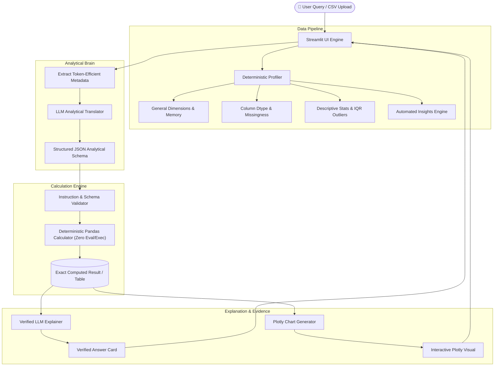

# ⚡ AI Analytics Engineer

> **Ask questions. Get verified answers. Understand your data with mathematical precision.**


---

## 🎯 Problem Statement & Core Principle

Traditional AI data chatbots often generate and execute arbitrary code via `eval()` or hallucinate numerical figures directly. This leads to severe security vulnerabilities, broken runtime execution, and untrustworthy results.

**AI Analytics Engineer** solves this with a strict architectural paradigm:

$$\boxed{\textbf{The LLM is the Analyst's Brain} \quad\longleftrightarrow\quad \textbf{Python/Pandas is the Calculator}}$$

1. **Zero Arbitrary Code Execution**: The LLM never writes raw executable scripts. Instead, it interprets user queries into a **strictly validated structured JSON schema**.
2. **100% Deterministic Calculations**: Native Pandas methods execute calculations, rankings, aggregations, and correlations.
3. **Verified Factual Explanations**: The LLM receives the exact computed result from Python and explains it without inventing or changing numbers.
4. **Full Transparency**: Every query displays the exact analytical steps executed and the underlying structured JSON.

---

## 🏗️ System Architecture



---

## ✨ Features

- **Automatic Dataset Profiling**:
  - Row/column counts, memory usage, duplicate row detection.
  - Column data type classification, unique counts, missing counts & percentages.
  - Numerical 5-number summary (count, mean, median, standard deviation, min, 25%, 50%, 75%, max, sum).
  - Categorical frequency distributions and cardinality analysis.
  - Pearson correlation matrix across numerical variables.
  - Explainable **IQR-based Outlier Detection** ($Q_1 - 1.5 \times \text{IQR}$ to $Q_3 + 1.5 \times \text{IQR}$).
- **Automated Insights Engine**:
  - Automatically identifies dominant categories, top revenue drivers, high-missingness columns, strong correlations, and anomalies without hallucination.
- **Natural Language Question Answering**:
  - Translates queries into schema-driven instructions (`aggregate`, `groupby_aggregate`, `top_n`, `bottom_n`, `filter`, `correlation`, `time_series`, `distribution`, `missing_values`, `outliers`, `comparison`).
  - Dual-mode operation: Powered by OpenAI (`gpt-4o-mini`, `gpt-4o`) with an intelligent deterministic fallback engine when operating offline.
- **Interactive Visualizations (Plotly)**:
  - Dynamic bar charts, line trends, scatter plots, histograms, correlation heatmaps, and outlier box plots.
- **Auditability & Transparency**:
  - Every answer includes an **"Analysis Performed"** trail and collapsible JSON instruction inspection.

---

## 🛠️ Tech Stack

- **Language:** Python 3.10+
- **Frontend / Application:** Streamlit
- **Data Engine:** Pandas, NumPy
- **Visualizations:** Plotly Express & Plotly Graph Objects
- **LLM Integration:** OpenAI API (`openai>=1.10.0`), `python-dotenv`
- **Testing:** Pytest

---

## 📂 Project Structure

```text
ai-analytics-engine/
│
├── app.py                      # Main Streamlit application frontend
├── requirements.txt            # Minimal core dependencies
├── .env.example                # Example environment variable file
├── .gitignore                  # Git ignore rules
├── pytest.ini                  # Pytest configuration
├── README.md                   # Comprehensive documentation
│
├── src/
│   ├── __init__.py             # Package initializer
│   ├── profiler.py             # Dataset profiling, stats, & automated insights
│   ├── analyzer.py             # Deterministic Pandas calculator & schema dispatcher
│   ├── visualizer.py           # Plotly visualization engine
│   └── llm.py                  # LLM translation & verified answer explanation
│
├── tests/
│   ├── test_profiler.py        # Profiler and statistics unit tests
│   ├── test_analyzer.py        # Analytical operations unit tests
│   └── test_e2e_integration.py # Full end-to-end integration tests
│
└── data/
    └── sample.csv              # Realistic 2025 e-commerce multi-variable dataset
```

---

## 🚀 Quick Start

### 1. Clone & Setup Environment

```bash
git clone https://github.com/TanishKadakia/ai-analytics-engine.git
cd ai-analytics-engine

# Create virtual environment
python -m venv .venv

# Activate virtual environment
# Windows (PowerShell):
.\.venv\Scripts\Activate.ps1
# macOS/Linux:
source .venv/bin/activate

# Install dependencies
pip install -r requirements.txt
```

### 2. Configure Environment Variables (Optional)

Copy `.env.example` to `.env` and insert your OpenAI API key:

```bash
cp .env.example .env
```

Edit `.env`:
```env
OPENAI_API_KEY=sk-your-actual-api-key
OPENAI_MODEL=gpt-4o-mini
```

*(Note: If no API key is provided, the application automatically runs in fast deterministic heuristic calculator mode).*

### 3. Run the Application

```bash
streamlit run app.py
```

Open your browser and navigate to `http://localhost:8501`.

---

## 💡 Example Questions & Workflows

Click **"🚀 Load Sample"** in the sidebar to load the built-in 2025 E-Commerce dataset, then test queries such as:

| Category | Example Question |
| :--- | :--- |
| **Aggregations** | *"What is the average revenue?"* |
| **Rankings / GroupBy** | *"Which product generated the most revenue?"* |
| **Categorical Breakdown** | *"What is the total revenue by category?"* |
| **Top N Queries** | *"What are the top 5 products by units_sold?"* |
| **Time Series Trends** | *"How did revenue change over time?"* |
| **Correlations** | *"Is advertising_spend related to revenue?"* |
| **Distributions** | *"Show distribution of customer_rating"* |
| **Outlier Scans** | *"Show outliers in revenue"* |
| **Data Quality** | *"Which columns have missing values?"* |

---

## 🧪 Running Tests

Run the complete test suite with `pytest`:

```bash
pytest -v
```

All 42 unit and integration tests validate:
- Statistical profiling and IQR outlier detection.
- Mathematical accuracy of all supported analytical operations.
- Input validation and defensive error handling for non-existent columns.
- End-to-end question translation, execution, explanation, and chart rendering.

---

## 🔒 Security & Reliability

- **No Code Execution**: Neither `exec()` nor `eval()` is used anywhere in the codebase.
- **Input Sanitization**: Column names and operations are sanitized and mapped strictly against the verified DataFrame schema.
- **Privacy First**: Only schema metadata (column names, types, summary metrics) is sent to the LLM; raw data rows are not uploaded unnecessarily.
- **Key Safety**: API keys are loaded via `.env` or password inputs and excluded from version control via `.gitignore`.

---

## 📜 License

MIT License. Developed for portfolio demonstration and production-grade data intelligence workflows.
